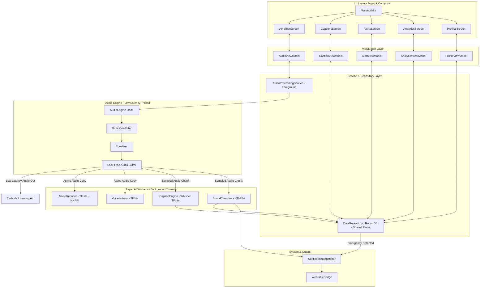
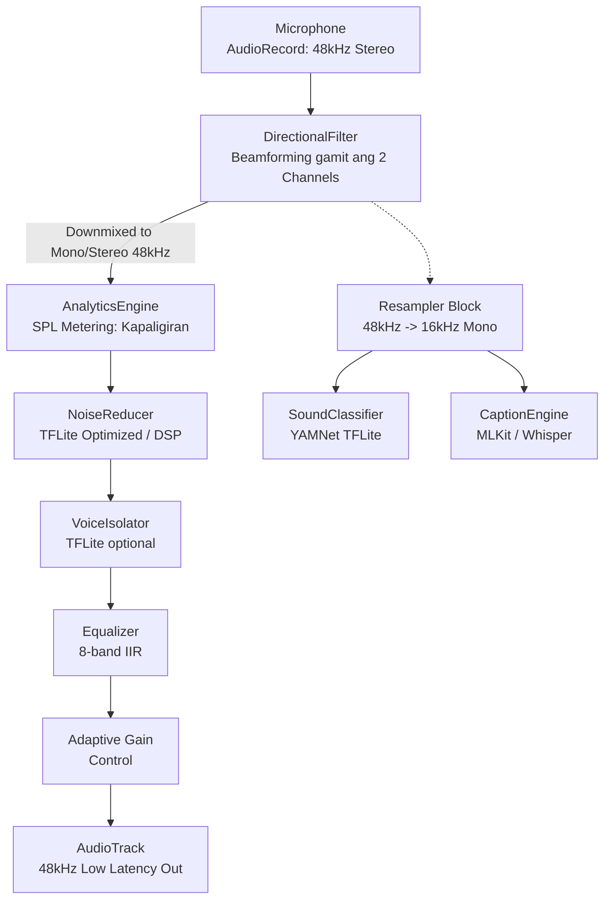
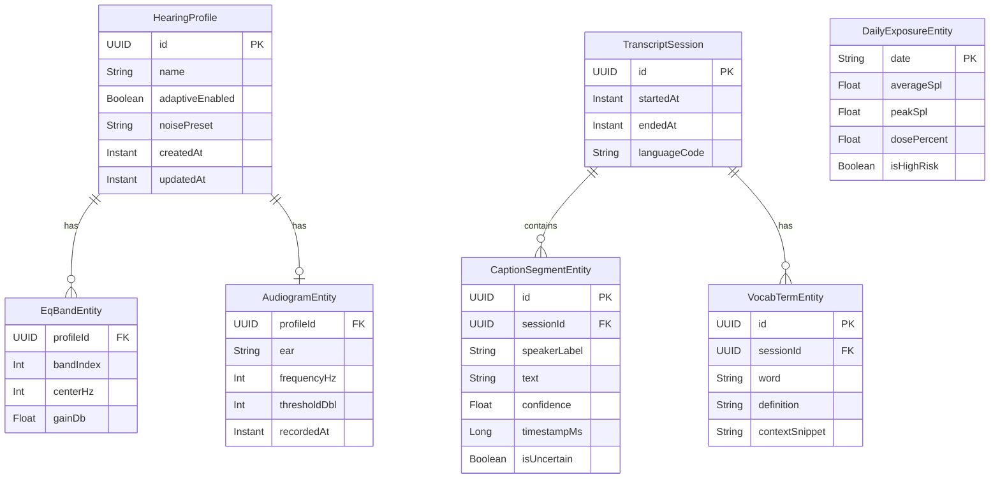

# Design Document: Advanced Hearing Aid App

## Overview

The Advanced Hearing Aid App is an Android application built with Kotlin and Jetpack Compose that transforms a smartphone into a sophisticated assistive hearing device. It combines real-time audio processing, AI-powered noise reduction and voice isolation, live speech-to-text captioning, sound recognition, emergency detection, hearing health analytics, and wearable integration into a single cohesive experience.

The app targets users with hearing loss, hard-of-hearing individuals, and those needing situational hearing enhancement. It must operate with very low latency (≤20 ms end-to-end for audio), provide robust on-device AI processing, and maintain continuous background operation via a foreground Android Service.

### Key Design Goals

- **Low latency audio pipeline**: End-to-end audio processing under 20 ms using Android's `AudioRecord`/`AudioTrack` (or `AAUDIO`/`Oboe`) with EXCLUSIVE mode.
- **On-device AI first**: All audio AI (noise reduction, voice isolation, sound classification) runs entirely on-device using TensorFlow Lite models; cloud AI is opt-in only for language features.
- **Privacy by default**: No raw audio ever leaves the device without explicit user consent.
- **Foreground Service resilience**: All continuous processing runs inside an `AudioProcessingService` foreground service to prevent OS termination.
- **Modular architecture**: Each major sub-system (audio, captions, analytics, wearable) is a standalone component with a clean interface, enabling independent development and testing.

---

## Architecture

The app follows a layered, MVVM-inspired architecture with a central foreground service acting as the audio processing hub.



### Architecture Layers

**UI Layer**: Jetpack Compose screens bound to ViewModels via `StateFlow`. The UI never directly calls processing components; all interactions go through ViewModels.

**ViewModel Layer**: Each screen has a dedicated ViewModel that exposes `StateFlow<UiState>` and handles user intent. ViewModels communicate with the `AudioProcessingService` via a bound service connection and with repositories for persistent data.

**Service Layer**: `AudioProcessingService` is a foreground service with a `FOREGROUND_SERVICE_TYPE_MICROPHONE` declaration. It owns the audio thread, orchestrates all processing components, and publishes results through shared `StateFlow`s that ViewModels collect.

**Processing Layer**: Independent components that each own their specific concern. They communicate through well-defined interfaces rather than direct references where possible.

**Persistence Layer**: Room database for transcripts, audiograms, analytics, and profiles. DataStore for user preferences and settings.

### Audio Processing Pipeline



The pipeline processes 10 ms audio frames at 16 kHz, 16-bit mono. Each stage operates on shared native buffers to minimize copies and garbage collection pauses.

---

## Components and Interfaces

### AudioEngine

Manages `AudioRecord` and `AudioTrack` instances in EXCLUSIVE/low-latency mode. Runs on a dedicated high-priority thread.

```kotlin
interface AudioEngine {
    val state: StateFlow<AudioEngineState>
    fun start(config: AudioConfig)
    fun stop()
    fun setGain(dB: Float)          // 0..40 dB
    fun setAdaptiveMode(enabled: Boolean)
    fun addProcessingStage(stage: AudioProcessingStage)
}

data class AudioConfig(
    val sampleRate: Int = 16_000,
    val channelCount: Int = 1,
    val frameSize: Int = 160,       // 10 ms at 16kHz
    val outputDevice: AudioDevice
)

enum class AudioEngineState { IDLE, STARTING, RUNNING, PAUSED, ERROR }
```

### NoiseReducer

TFLite model-based spectral noise suppression. Falls back to classical spectral subtraction if the model fails to load.

```kotlin
interface NoiseReducer : AudioProcessingStage {
    val isModelLoaded: StateFlow<Boolean>
    fun setEnvironmentPreset(preset: EnvironmentPreset)
    fun setEnabled(enabled: Boolean)
}

enum class EnvironmentPreset { DEFAULT, RESTAURANT, CLASSROOM, OUTDOORS, OFFICE }
```

### VoiceIsolator

Speaker separation model. Passes audio through unmodified when no speech is detected for >5 seconds.

```kotlin
interface VoiceIsolator : AudioProcessingStage {
    val dominantSpeakerConfidence: StateFlow<Float>
    fun setEnabled(enabled: Boolean)
}
```

### DirectionalFilter

Beamforming using dual-microphone input. Disabled with a user-visible message on single-mic devices.

```kotlin
interface DirectionalFilter : AudioProcessingStage {
    val isAvailable: StateFlow<Boolean>    // false on single-mic devices
    fun setDirection(direction: AudioDirection)
}

sealed class AudioDirection {
    object Front : AudioDirection()
    object Left : AudioDirection()
    object Right : AudioDirection()
    object Rear : AudioDirection()
    data class Custom(val azimuthDegrees: Float) : AudioDirection()
}
```

### Equalizer

8-band IIR filter with bands at 250, 500, 1000, 2000, 3000, 4000, 6000, and 8000 Hz.

```kotlin
interface Equalizer : AudioProcessingStage {
    val bands: StateFlow<List<EqBand>>
    fun setBandGain(bandIndex: Int, gainDb: Float)   // -20..+40 dB
    fun applyAudiogram(audiogram: Audiogram)
    fun reset()
}

data class EqBand(val centerHz: Int, val gainDb: Float)
```

### CaptionEngine

Wraps Android's `SpeechRecognizer` (on-device via ML Kit) with speaker diarization.

```kotlin
interface CaptionEngine {
    val captions: StateFlow<List<CaptionSegment>>
    val isActive: StateFlow<Boolean>
    fun start(languageCode: String)
    fun stop()
    fun setConfidenceThreshold(threshold: Float)   // default 0.70
}

data class CaptionSegment(
    val id: UUID,
    val speakerLabel: String,
    val text: String,
    val confidence: Float,
    val timestampMs: Long,
    val isUncertain: Boolean    // confidence < 0.70
)
```

### SoundClassifier

YAMNet TFLite model classifying 521 AudioSet classes, mapped to 20+ app-level categories. Runs in parallel with the audio pipeline on a separate thread.

```kotlin
interface SoundClassifier {
    val detections: SharedFlow<SoundDetection>
    fun setEnabledCategories(categories: Set<SoundCategory>)
    fun setEnabled(enabled: Boolean)
}

data class SoundDetection(
    val category: SoundCategory,
    val confidence: Float,
    val timestampMs: Long
)

enum class SoundCategory {
    DOORBELL, BABY_CRYING, FIRE_ALARM, CAR_HORN, DOG_BARKING,
    NAME_CALLED, KNOCK, PHONE_RINGING, WATER_RUNNING, GLASS_BREAKING,
    SIREN, SMOKE_ALARM, CROWD_CHEERING, BIRDS, THUNDER, SPEECH,
    CO_ALARM, FIRE_TRUCK_SIREN, AMBULANCE_SIREN, POLICE_SIREN, VERBAL_HELP
}
```

### EmergencyDetector

Subscribes to `SoundClassifier` and applies an 85% confidence threshold for life-safety sounds.

```kotlin
interface EmergencyDetector {
    val emergencyEvents: SharedFlow<EmergencyEvent>
    val isActive: StateFlow<Boolean>
}

data class EmergencyEvent(
    val category: SoundCategory,
    val confidence: Float,
    val detectedAtMs: Long
)
```

### AIAssistant

Wraps Gemini Nano (on-device) for offline capabilities and Gemini API for cloud features. Automatically falls back to on-device when offline.

```kotlin
interface AIAssistant {
    val importantPoints: SharedFlow<ImportantPoint>
    val isOnlineMode: StateFlow<Boolean>
    suspend fun summarize(transcript: List<CaptionSegment>): String
    suspend fun translate(text: String, targetLanguage: String): String
    suspend fun define(word: String): String
    suspend fun generateStudyNotes(transcript: List<CaptionSegment>): StudyNotes
    suspend fun describeSound(category: SoundCategory, context: String): String
}
```

### AnalyticsEngine

Continuously meters output SPL and computes NIOSH noise dose.

```kotlin
interface AnalyticsEngine {
    val currentSplDb: StateFlow<Float>
    val dailyDosePercent: StateFlow<Float>
    val dashboardData: StateFlow<AnalyticsDashboard>
    suspend fun generateTrendReport(days: Int = 30): TrendReport
}

data class AnalyticsDashboard(
    val currentSpl: Float,
    val dailyDose: Float,
    val weeklyTrend: List<DailyExposure>,
    val peakLevel: Float
)
```

### ProfileManager

Manages hearing profiles stored in Room. A profile bundles EQ settings, adaptive amplification settings, and audiogram data.

```kotlin
interface ProfileManager {
    val profiles: StateFlow<List<HearingProfile>>
    val activeProfile: StateFlow<HearingProfile?>
    suspend fun saveProfile(profile: HearingProfile)
    suspend fun activateProfile(profileId: UUID)
    suspend fun deleteProfile(profileId: UUID)
}
```

### WearableBridge

Manages Bluetooth Classic (A2DP/HFP) and BLE connections with automatic reconnection.

```kotlin
interface WearableBridge {
    val connectedDevices: StateFlow<List<BluetoothDeviceInfo>>
    fun sendAlert(alert: SoundAlert)
    fun sendCaptions(segment: CaptionSegment)
    fun startReconnect(deviceAddress: String)
}

data class BluetoothDeviceInfo(
    val address: String,
    val name: String,
    val batteryPercent: Int?,   // null if not exposed
    val supportsDisplay: Boolean
)
```

### NotificationDispatcher

Routes alerts to the correct output channel based on user preferences.

```kotlin
interface NotificationDispatcher {
    fun dispatch(detection: SoundDetection, priority: AlertPriority)
    fun setChannels(channels: Set<AlertChannel>)
    fun setFlashlightPattern(pattern: FlashlightPattern)
}

enum class AlertChannel { SCREEN_BANNER, VIBRATION, FLASHLIGHT, SMARTWATCH }
enum class AlertPriority { HIGH, LOW }
enum class FlashlightPattern { SHORT, LONG, SOS }
```

### TranscriptStore

Room-backed repository for captions, audio recordings, and vocabulary lists.

```kotlin
interface TranscriptStore {
    suspend fun saveSegment(segment: CaptionSegment, sessionId: UUID)
    suspend fun getSession(sessionId: UUID): List<CaptionSegment>
    suspend fun exportAsText(sessionId: UUID): File
    suspend fun exportAsPdf(sessionId: UUID): File
    suspend fun deleteAllData()
}
```

---

## Data Models

### HearingProfile

```kotlin
data class HearingProfile(
    val id: UUID = UUID.randomUUID(),
    val name: String,
    val eqBands: List<EqBand>,              // 8 bands
    val adaptiveAmplificationEnabled: Boolean,
    val noiseReductionPreset: EnvironmentPreset,
    val audiogram: Audiogram?,
    val createdAt: Instant,
    val updatedAt: Instant
)
```

### Audiogram

```kotlin
data class Audiogram(
    val profileId: UUID,
    val leftEar: Map<Int, Int>,     // frequency Hz -> threshold dBHL
    val rightEar: Map<Int, Int>,
    val recordedAt: Instant
)
// Frequencies tested: 250, 500, 1000, 2000, 4000, 8000 Hz
// Threshold range: 0–80 dBHL in 5 dB steps
```

### DailyExposure

```kotlin
data class DailyExposure(
    val date: LocalDate,
    val averageSpl: Float,
    val peakSpl: Float,
    val dosePercent: Float,         // NIOSH dose: 100% = 8h @ 85 dB SPL
    val isHighRisk: Boolean         // dose >= 100%
)
```

### StudyNotes

```kotlin
data class StudyNotes(
    val sessionId: UUID,
    val title: String,
    val keyTopics: List<String>,
    val vocabularyTerms: List<VocabTerm>,
    val summary: String,
    val generatedAt: Instant
)

data class VocabTerm(
    val word: String,
    val definition: String,
    val contextSnippet: String
)
```

### SoundAlert

```kotlin
data class SoundAlert(
    val category: SoundCategory,
    val confidence: Float,
    val priority: AlertPriority,
    val description: String?,       // AI-generated for spatial narration
    val detectedAtMs: Long
)
```

### Room Database Schema



### DataStore Preferences

User preferences are stored in Jetpack DataStore (Proto DataStore for type safety):

- `activeProfileId`: UUID
- `captionLanguageCode`: String (default "en-US")
- `translationTargetLanguage`: String
- `enabledSoundCategories`: Set<String>
- `alertChannels`: Set<String>
- `flashlightPattern`: String
- `cloudAiEnabled`: Boolean
- `ttsEnabled`: Boolean
- `privacyAudioUploadConsent`: Boolean


---

## Correctness Properties

*A property is a characteristic or behavior that should hold true across all valid executions of a system — essentially, a formal statement about what the system should do. Properties serve as the bridge between human-readable specifications and machine-verifiable correctness guarantees.*

### Property 1: Gain values are always clamped to the valid range

*For any* gain value set on the AudioEngine, the applied gain shall always be within the inclusive range [0 dB, 40 dB] and quantized to the nearest 1 dB increment. Values below 0 shall be clamped to 0; values above 40 shall be clamped to 40.

**Validates: Requirements 1.2, 6.3**

---

### Property 2: Noise reducer environment preset is applied correctly

*For any* `EnvironmentPreset` value selected by the user, the NoiseReducer's active configuration shall reflect a suppression profile matching that preset, and querying the current preset shall return the same value that was set.

**Validates: Requirements 2.4**

---

### Property 3: Equalizer always has at least 8 bands in the required frequency range

*For any* Equalizer instance, the number of bands shall be at least 8, and every band's center frequency shall be within the range [250 Hz, 8000 Hz].

**Validates: Requirements 5.1**

---

### Property 4: Equalizer band gain is always within the valid range

*For any* band index and any requested gain value, the Equalizer shall apply a gain within [-20 dB, +40 dB]. Values outside this range shall be clamped to the nearest bound.

**Validates: Requirements 5.2**

---

### Property 5: Equalizer profile round-trip persistence

*For any* equalizer configuration (a list of 8 band gains), saving it to a HearingProfile via ProfileManager and then loading that profile shall yield an identical band gain configuration.

**Validates: Requirements 5.3, 12.4**

---

### Property 6: Audiogram correctly maps to equalizer band gains

*For any* Audiogram with threshold measurements at the standard frequencies, applying the audiogram to the Equalizer shall produce band gains that correspond to the measured hearing thresholds — specifically, bands at frequencies with higher thresholds (more hearing loss) shall receive proportionally higher gain.

**Validates: Requirements 5.4, 12.3**

---

### Property 7: Caption segments with low confidence are marked uncertain

*For any* `CaptionSegment` produced by the CaptionEngine where the confidence score is strictly less than 0.70, the `isUncertain` field shall be `true`. For segments with confidence ≥ 0.70, `isUncertain` shall be `false`.

**Validates: Requirements 7.6**

---

### Property 8: Supported caption languages always include the required 11 languages

*For any* CaptionEngine instance, the set of supported language codes shall always contain at minimum the following 11 language codes: `fil` (Filipino), `en`, `es`, `fr`, `de`, `ar`, `zh`, `ja`, `ko`, `pt`, `hi`.

**Validates: Requirements 7.2**

---

### Property 9: Caption segments have speaker labels in multi-speaker sessions

*For any* CaptionSegment produced when more than one speaker has been detected in the session, the `speakerLabel` field shall be non-empty and distinct per speaker.

**Validates: Requirements 7.3**

---

### Property 10: Transcript session export round-trip

*For any* set of CaptionSegments saved to the TranscriptStore for a session, exporting that session as a text file shall produce a file whose content contains all the text from each saved segment.

**Validates: Requirements 7.4**

---

### Property 11: SoundClassifier supports at least 20 required sound categories

*For any* SoundClassifier instance, the set of detectable sound categories shall always include at minimum the 20 categories enumerated in Requirement 9.1 (doorbell, baby crying, fire alarm, car horn, dog barking, name called, knock, phone ringing, water running, glass breaking, siren, smoke alarm, crowd cheering, birds, thunder, speech, CO alarm, fire truck siren, ambulance siren, verbal help).

**Validates: Requirements 9.1**

---

### Property 12: Alert priority maps correctly from confidence score

*For any* `SoundDetection`, the `NotificationDispatcher` shall assign `AlertPriority.HIGH` when confidence ≥ 0.80 and `AlertPriority.LOW` when confidence is in [0.50, 0.79]. Detections with confidence below 0.50 shall not trigger any alert.

**Validates: Requirements 9.6, 9.2**

---

### Property 13: Flashlight pattern is applied as configured

*For any* configured `FlashlightPattern` (SHORT, LONG, or SOS), when the NotificationDispatcher dispatches a flashlight alert, the pattern used shall match the configured pattern exactly.

**Validates: Requirements 9.4**

---

### Property 14: Enabled sound categories filter determines alert dispatch

*For any* subset of SoundCategories enabled by the user, only detections whose category appears in that enabled set shall trigger alert dispatch. Detections for disabled categories shall be silently ignored.

**Validates: Requirements 9.5**

---

### Property 15: EmergencyDetector includes all required life-safety categories

*For any* EmergencyDetector instance, the set of monitored categories shall always include all six life-safety categories: smoke alarm, CO alarm, fire truck siren, ambulance siren, police siren, and verbal calls for help ("help", "fire", "emergency").

**Validates: Requirements 10.1**

---

### Property 16: NIOSH noise dose computation is correct for any SPL sequence

*For any* sequence of SPL measurements and their durations, the AnalyticsEngine's computed daily dose percentage shall equal the result of applying the NIOSH noise dose formula (85 dB SPL reference, 3 dB exchange rate): dose% = 100 × Σ(Cᵢ / Tᵢ), where Cᵢ is time at level Lᵢ and Tᵢ = 8h × 2^((85−Lᵢ)/3).

**Validates: Requirements 11.1**

---

### Property 17: Analytics dashboard always contains all required fields

*For any* `AnalyticsDashboard` value produced by the AnalyticsEngine, all four required fields shall be present and non-null: `currentSpl`, `dailyDose`, `weeklyTrend` (non-empty list), and `peakLevel`.

**Validates: Requirements 11.2**

---

### Property 18: Risk warning level matches dose thresholds

*For any* daily dose percentage value, the risk level displayed by the AnalyticsEngine shall be: NO_WARNING for dose < 50%, MODERATE_WARNING for 50% ≤ dose < 100%, and HIGH_WARNING for dose ≥ 100%.

**Validates: Requirements 11.3, 11.4**

---

### Property 19: Exposure data is retained for at least 90 days

*For any* daily exposure record stored by the AnalyticsEngine, querying the store at any point within 90 days of that record's date shall return that record. Records older than 90 days may be purged.

**Validates: Requirements 11.5**

---

### Property 20: Trend report aggregates the correct 30-day window

*For any* set of daily exposure records spanning at least 30 days, the generated trend report shall include: the average daily dose across the 30-day window, the count of days with dose ≥ 100%, and the maximum peak SPL recorded across that window.

**Validates: Requirements 11.6**

---

### Property 21: Hearing test frequencies and level steps are correct

*For any* Hearing_Test instance, the set of test frequencies shall exactly be {250, 500, 1000, 2000, 4000, 8000} Hz, and for each frequency the presentation levels shall be the set {0, 5, 10, ..., 80} dBHL (17 levels in 5 dB steps).

**Validates: Requirements 12.1**

---

### Property 22: Hearing test threshold recording round-trip

*For any* frequency, ear (left/right), and threshold level within [0, 80] dBHL (in 5 dB steps), recording that threshold during the Hearing_Test and then retrieving the audiogram shall yield the same frequency-ear-threshold mapping.

**Validates: Requirements 12.2**

---

### Property 23: Profiles exceeding 40 dBHL threshold trigger audiologist recommendation

*For any* Audiogram where at least one threshold value (for any frequency, either ear) exceeds 40 dBHL, the ProfileManager shall set the audiologist recommendation flag to `true` when storing that audiogram.

**Validates: Requirements 12.6**

---

### Property 24: New vocabulary words are added with non-empty definitions

*For any* word that does not appear in the user's existing vocabulary list, after the AIAssistant processes a transcript segment containing that word, the vocabulary list shall contain an entry for that word with a non-empty definition string.

**Validates: Requirements 13.3**

---

### Property 25: Vocabulary list clear is idempotent

*For any* vocabulary list state (empty or non-empty), clearing the vocabulary list shall result in an empty list, and clearing an already-empty list shall leave it empty. Clearing twice produces the same result as clearing once.

**Validates: Requirements 13.4**

---

### Property 26: Battery level is present for devices that expose it, null otherwise

*For any* connected BluetoothDeviceInfo, if the device exposes battery information via GATT or HFP, the `batteryPercent` field shall be non-null and in [0, 100]. For devices that do not expose battery information, `batteryPercent` shall be null.

**Validates: Requirements 14.5**

---

### Property 27: Caption text is forwarded to display-capable wearables

*For any* CaptionSegment produced while a display-capable wearable is connected (i.e., `BluetoothDeviceInfo.supportsDisplay == true`), the WearableBridge shall transmit that segment's text to the wearable. No transmission shall occur for non-display-capable devices.

**Validates: Requirements 14.6**

---

### Property 28: Every detected sound event produces a non-empty natural language description

*For any* SoundDetection emitted by the SoundClassifier while environmental awareness mode is active, the AIAssistant shall produce a description string that is non-empty and references the detected sound category.

**Validates: Requirements 15.1**

---

### Property 29: Sound description queue depth never exceeds 5

*For any* sequence of sound events dispatched while the description queue is full (already at 5 items), adding a new item shall result in the oldest item being discarded, keeping the queue size at exactly 5.

**Validates: Requirements 15.3**

---

### Property 30: Same-category events within 3 seconds are merged

*For any* two SoundDetection events of the same `SoundCategory` where the difference in `timestampMs` is ≤ 3000 ms, the description queue shall contain exactly one merged card for those events rather than two separate cards.

**Validates: Requirements 15.5**

---

### Property 31: Disabling a permission disables all dependent features

*For any* permission that has been granted and is subsequently revoked, every feature that lists that permission as a dependency shall transition to a disabled state, and no disabled feature shall be accessible until the permission is re-granted.

**Validates: Requirements 16.3**

---

### Property 32: Data deletion leaves no retrievable user data

*For any* state where user data exists in the app (transcripts, audiograms, analytics records, vocabulary), after the user confirms data deletion, querying any of those data stores shall return empty collections or null values.

**Validates: Requirements 16.5**

---

## Error Handling

### Audio Engine Errors

| Error Condition | Handling Strategy |
|---|---|
| `AudioRecord` fails to initialize | Show error dialog, disable audio features, suggest checking mic permission |
| Microphone permission revoked at runtime | Pause AudioProcessingService, notify user, disable audio-dependent features |
| Output device disconnect | Pause audio output within 2 s, show reconnect banner |
| Buffer underrun / overrun | Log metric, skip frame, do not crash |
| Gain computation overflow | Clamp to 40 dB, log warning |

### AI Model Errors

| Error Condition | Handling Strategy |
|---|---|
| TFLite model fails to load | NoiseReducer falls back to spectral subtraction; user notified via snackbar |
| YAMNet classification throws exception | SoundClassifier emits no event for that frame; logs error |
| Gemini Nano unavailable | AIAssistant marks `isOnlineMode = false`; uses on-device fallback for supported ops |
| Cloud AI API error (5xx) | Retry once after 2 s; if still failing, fall back to on-device; show banner |
| Speech recognizer unavailable | CaptionEngine shows "Captions unavailable" overlay; logs error |

### Storage Errors

| Error Condition | Handling Strategy |
|---|---|
| Room database write failure | Retry up to 3 times; if still failing, log and surface an error to ViewModel |
| Disk full on transcript export | Show "Storage full" error dialog; do not create partial files |
| DataStore corruption | Reset preferences to defaults; do not crash |

### Bluetooth / Wearable Errors

| Error Condition | Handling Strategy |
|---|---|
| BLE connection lost | WearableBridge starts 30-second reconnect loop; notifies user after timeout |
| A2DP routing failure | AudioEngine falls back to earpiece/speaker output; notifies user |
| GATT battery read failure | Set `batteryPercent = null`; do not surface an error to the user |

### Emergency SOS Errors

| Error Condition | Handling Strategy |
|---|---|
| GPS unavailable at SOS time | Send SMS with last known location + staleness timestamp |
| SMS send failure | Retry 3 times; show "SMS failed" on emergency screen with manual dial option |
| No SOS contacts configured | Show "No emergency contacts configured" before sending |

---

## Testing Strategy

### Dual Testing Approach

This app uses both unit/example tests and property-based tests. They are complementary:

- **Unit/example tests** validate specific behaviors, edge cases, error conditions, and UI flows that are one-off scenarios.
- **Property-based tests** verify universal invariants across large random input spaces, catching edge cases that manual tests would miss.

### Property-Based Testing

The property-based testing library for this project is **Kotest Property Testing** (`io.kotest:kotest-property`), which is idiomatic for Kotlin and integrates with JUnit 4/5.

Each property-based test must:
- Run a minimum of **100 iterations** (set via `PropTestConfig(iterations = 100)`).
- Be tagged with a comment referencing the design property it validates.
- Format: `// Feature: advanced-hearing-aid-app, Property N: <property_text>`

Each correctness property listed above shall be implemented by exactly one property-based test.

**Example property test structure:**

```kotlin
// Feature: advanced-hearing-aid-app, Property 1: Gain values are always clamped to the valid range
class AudioEngineGainPropertyTest : FreeSpec({
    "gain is always within [0, 40] dB" {
        checkAll(PropTestConfig(iterations = 100), Arb.float(-100f, 100f)) { requestedGain ->
            val engine = FakeAudioEngine()
            engine.setGain(requestedGain)
            val applied = engine.currentGain
            applied shouldBeGreaterThanOrEqualTo 0f
            applied shouldBeLessThanOrEqualTo 40f
        }
    }
})
```

### Unit / Example Tests

Unit tests shall use **JUnit 4** (already in the project) with **MockK** for mocking Android and service dependencies.

Key unit test areas:

- **Permission flow**: Verify that the rationale screen appears before each permission request (Req 1.4, 16.1).
- **Noise reducer fallback**: Verify that when TFLite model load fails, `isModelLoaded = false` and spectral subtraction is active (Req 2.5).
- **Single-microphone directional disable**: Verify `DirectionalFilter.isAvailable = false` and appropriate message shown (Req 4.3).
- **SPL loudness clamp**: Verify that output is clamped and warning displayed when level approaches 85 dB SPL (Req 6.4).
- **AI offline fallback**: Verify that `AIAssistant` switches mode on network loss and re-enables on restore (Req 8.6).
- **SOS with unavailable GPS**: Verify last-known-location is included in SMS with staleness note (Req 10.4).
- **Classroom mode activation**: Verify all three components (CaptionEngine, AIAssistant, TranscriptStore) are enabled atomically (Req 13.1).
- **Smartwatch alert forwarding**: Verify alerts are sent to wearable when connected (Req 14.3).
- **Data deletion confirmation**: Verify all Room tables are empty and DataStore preferences are cleared after deletion (Req 16.5).

### Instrumented / Integration Tests

Some behaviors require Android instrumentation:

- **Foreground service stays alive**: Verify `AudioProcessingService` remains running and shows notification (Req 1.3).
- **Bluetooth audio routing**: Verify `AudioEngine` routes to connected A2DP device (Req 14.2).
- **Transcript export creates readable file**: Verify the exported file exists and is non-empty (Req 7.4, 7.5).

These run on a physical device or emulator using `AndroidJUnitRunner`.

### Test File Organization

```
app/src/test/java/com/example/tryhearingaid/
├── audio/
│   ├── AudioEngineTest.kt          // Unit + Property (Props 1)
│   ├── EqualizerTest.kt            // Unit + Property (Props 3, 4, 5, 6)
│   └── AdaptiveGainTest.kt         // Unit + Property (Prop 1 adaptive mode)
├── captions/
│   ├── CaptionEngineTest.kt        // Unit + Property (Props 7, 8, 9)
│   └── TranscriptStoreTest.kt      // Unit + Property (Prop 10)
├── classification/
│   ├── SoundClassifierTest.kt      // Unit + Property (Props 11, 12, 14)
│   ├── EmergencyDetectorTest.kt    // Unit + Property (Prop 15)
│   └── NotificationDispatcherTest.kt // Unit + Property (Props 12, 13)
├── analytics/
│   ├── AnalyticsEngineTest.kt      // Unit + Property (Props 16, 17, 18, 19, 20)
│   └── NioshDoseTest.kt            // Property (Prop 16)
├── profiles/
│   ├── ProfileManagerTest.kt       // Unit + Property (Props 5, 6, 22, 23)
│   └── HearingTestTest.kt          // Unit + Property (Props 21, 22)
├── ai/
│   ├── AIAssistantTest.kt          // Unit (offline fallback, word definitions)
│   └── VocabularyTest.kt           // Unit + Property (Props 24, 25)
├── wearable/
│   └── WearableBridgeTest.kt       // Unit + Property (Props 26, 27)
├── environmental/
│   └── SpatialNarrationTest.kt     // Unit + Property (Props 28, 29, 30)
└── privacy/
    └── PermissionsPrivacyTest.kt   // Unit + Property (Props 31, 32)
```

### Property Test Dependencies

Add to `app/build.gradle.kts`:

```kotlin
testImplementation("io.kotest:kotest-runner-junit4:5.9.1")
testImplementation("io.kotest:kotest-property:5.9.1")
testImplementation("io.mockk:mockk:1.13.11")
```
